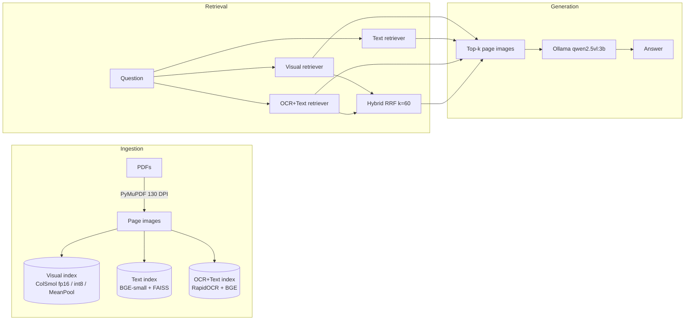
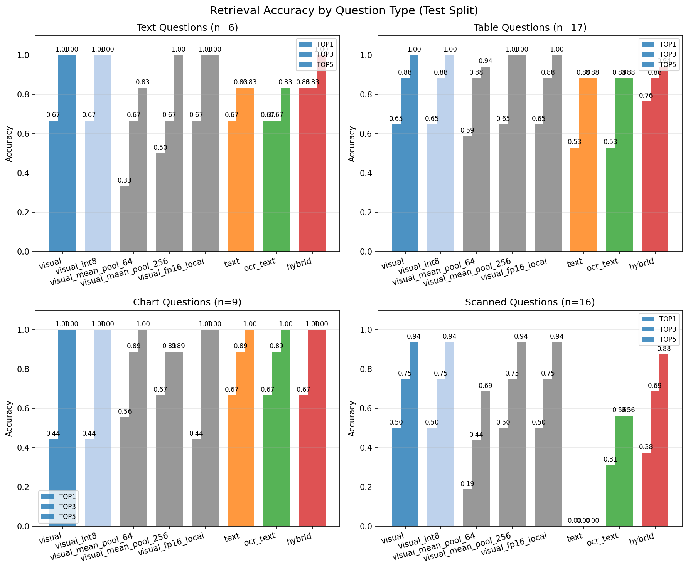
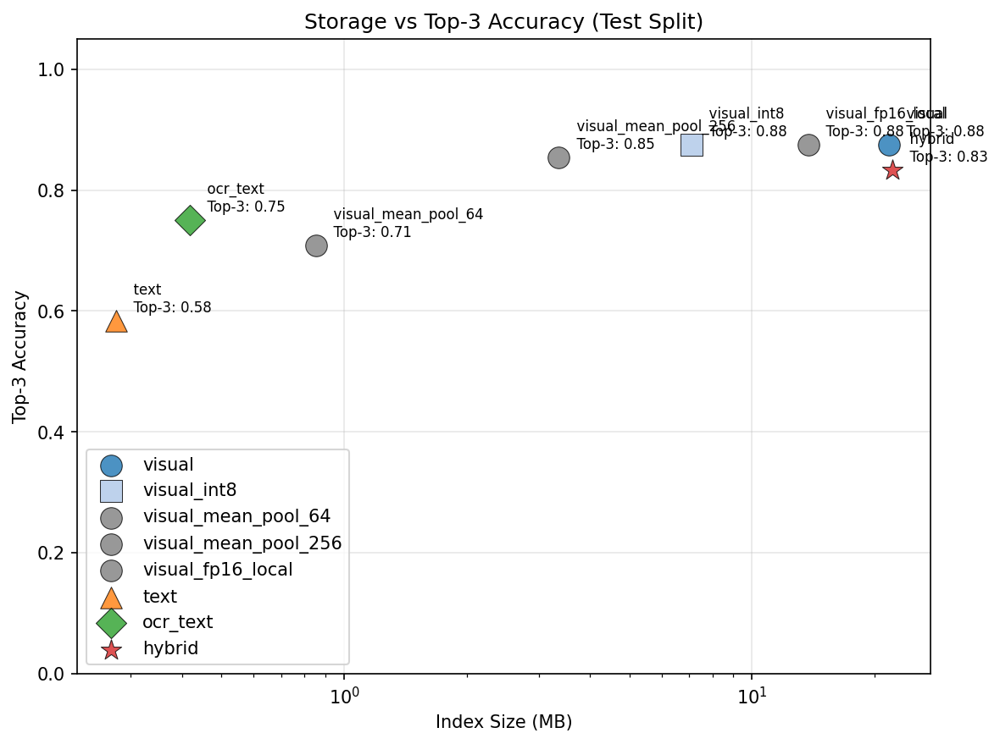
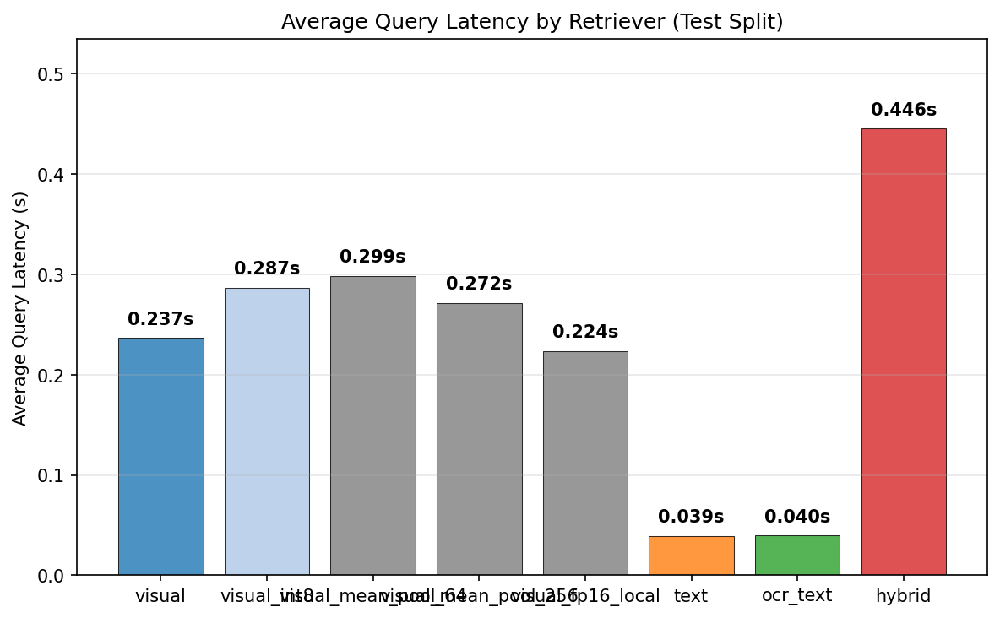
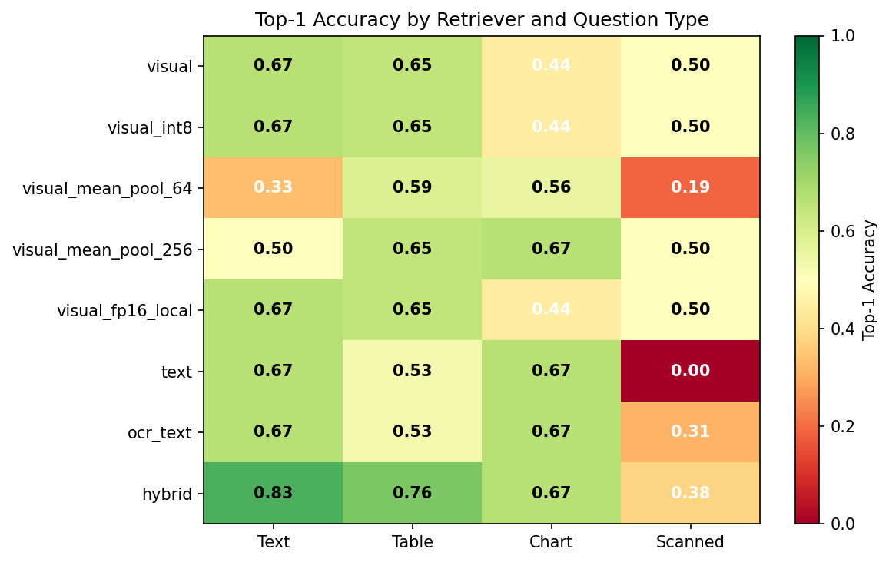

# VisionRAG

**Fully local visual document QA** — ColPali-style visual retriever (ColSmol-256M) + Ollama VLM (qwen2.5vl:3b). CPU-only. Retriever peak memory 2.81 GB (measured during indexing); the VLM generation step was not memory-profiled. Developed and measured on a 16 GB CPU-only laptop. No Poppler needed.

## Problem Statement
Answer questions about PDFs containing charts, tables, diagrams, and scanned pages — using **visual embeddings** of rendered pages rather than extracted text. The main retriever is visual; text, OCR+text and hybrid retrievers are baselines. Generation uses a local VLM.

## Architecture



*app.py: any retriever (visual, text, OCR+Text, hybrid, compressed variants) can feed generation. src/pipeline.py CLI supports visual and text only.*

## Results (60 labeled questions: 12 dev / 48 test)

### Overall Retrieval Performance

| Retriever | Top-1 | Top-3 | Top-5 | MRR | Avg Latency (s) | Build (s) | Size (MB) |
|-----------|-------|-------|-------|-----|-----------------|-----------|-----------|
| visual | 0.562 (0.417, 0.708) | **0.875** (0.771, 0.958) | **0.979** (0.938, 1.000) | 0.727 (0.639, 0.821) | 0.28 | 520.6 | 21.61 |
| visual_int8 | 0.562 (0.417, 0.708) | **0.875** (0.771, 0.958) | **0.979** (0.938, 1.000) | 0.727 (0.639, 0.821) | 0.37 | 0.1 | 7.11 |
| visual_mean_pool_64 | 0.417 (0.271, 0.542) | 0.708 (0.583, 0.833) | 0.854 (0.750, 0.938) | 0.565 (0.447, 0.671) | 0.37 | 0.2 | 0.85 |
| visual_mean_pool_256 | 0.583 (0.438, 0.729) | 0.854 (0.750, 0.958) | 0.958 (0.896, 1.000) | 0.724 (0.631, 0.823) | 0.37 | 0.6 | 3.36 |
| visual_fp16_local | 0.562 (0.417, 0.708) | **0.875** (0.771, 0.958) | **0.979** (0.938, 1.000) | 0.727 (0.639, 0.821) | 0.27 | 0.1 | 13.74 |
| text | 0.396 (0.250, 0.542) | 0.583 (0.458, 0.729) | 0.604 (0.479, 0.750) | 0.477 (0.351, 0.608) | 0.06 | 16.5 | 0.28 |
| ocr_text | 0.500 (0.354, 0.625) | 0.750 (0.625, 0.854) | 0.792 (0.667, 0.896) | 0.615 (0.497, 0.722) | 0.05 | 211.4 | 0.42 |
| hybrid | **0.625** (0.479, 0.750) | 0.833 (0.729, 0.938) | 0.938 (0.854, 1.000) | **0.738** (0.634, 0.837) | 0.52 | 731.9 | 22.03 |

*Overall CIs: bootstrap (1000 resamples, seed 42). By-type CIs: Wilson score interval. Hybrid build time = visual (520.6 s) + OCR+Text (211.4 s) = 731.9 s (computed from unrounded values); derived compressed indexes (int8, MeanPool, local) exclude the fp16 build time.*

### By Question Type — Top-1 (Wilson 95% CIs)

| Retriever | Text (6) | Table (17) | Chart (9) | Scanned (16) |
|-----------|----------|------------|-----------|--------------|
| **visual** | 0.667 (0.300, 0.903) | 0.647 (0.413, 0.827) | 0.444 (0.189, 0.733) | 0.500 (0.280, 0.720) |
| **visual_int8** | 0.667 (0.300, 0.903) | 0.647 (0.413, 0.827) | 0.444 (0.189, 0.733) | 0.500 (0.280, 0.720) |
| **visual_mean_pool_64** | 0.333 (0.097, 0.700) | 0.588 (0.360, 0.784) | 0.556 (0.267, 0.811) | 0.188 (0.066, 0.430) |
| **visual_mean_pool_256** | 0.500 (0.188, 0.812) | 0.647 (0.413, 0.827) | 0.667 (0.354, 0.879) | 0.500 (0.280, 0.720) |
| **visual_fp16_local** | 0.667 (0.300, 0.903) | 0.647 (0.413, 0.827) | 0.444 (0.189, 0.733) | 0.500 (0.280, 0.720) |
| **text** | 0.667 (0.300, 0.903) | 0.529 (0.310, 0.738) | 0.667 (0.354, 0.879) | 0.000 (0.000, 0.194) |
| **ocr_text** | 0.667 (0.300, 0.903) | 0.529 (0.310, 0.738) | 0.667 (0.354, 0.879) | 0.312 (0.142, 0.556) |
| **hybrid** | **0.833** (0.436, 0.970) | **0.765** (0.527, 0.904) | 0.667 (0.354, 0.879) | 0.375 (0.185, 0.614) |

### By Question Type — Top-3 (Wilson 95% CIs)

| Retriever | Text (6) | Table (17) | Chart (9) | Scanned (16) |
|-----------|----------|------------|-----------|--------------|
| **visual** | 1.000 (0.610, 1.000) | 0.882 (0.657, 0.967) | 1.000 (0.701, 1.000) | 0.750 (0.505, 0.898) |
| **visual_int8** | 1.000 (0.610, 1.000) | 0.882 (0.657, 0.967) | 1.000 (0.701, 1.000) | 0.750 (0.505, 0.898) |
| **visual_mean_pool_64** | 0.667 (0.300, 0.903) | 0.882 (0.657, 0.967) | 0.889 (0.565, 0.980) | 0.438 (0.231, 0.668) |
| **visual_mean_pool_256** | 0.667 (0.300, 0.903) | 1.000 (0.816, 1.000) | 0.889 (0.565, 0.980) | 0.750 (0.505, 0.898) |
| **visual_fp16_local** | 1.000 (0.610, 1.000) | 0.882 (0.657, 0.967) | 1.000 (0.701, 1.000) | 0.750 (0.505, 0.898) |
| **text** | 0.833 (0.436, 0.970) | 0.882 (0.657, 0.967) | 0.889 (0.565, 0.980) | 0.000 (0.000, 0.194) |
| **ocr_text** | 0.667 (0.300, 0.903) | 0.882 (0.657, 0.967) | 0.889 (0.565, 0.980) | 0.562 (0.332, 0.769) |
| **hybrid** | 0.833 (0.436, 0.970) | 0.882 (0.657, 0.967) | 1.000 (0.701, 1.000) | 0.688 (0.444, 0.858) |

*Top-5 and MRR by type are in docs/results.md.*

### Non-Scanned Questions (n=32)

| Retriever | Top-1 | Top-3 | Top-5 |
|-----------|-------|-------|-------|
| visual | 19/32 (59.4%) | 30/32 (93.8%) | 32/32 (100%) |
| text | 19/32 (59.4%) | 28/32 (87.5%) | 29/32 (90.6%) |
| ocr_text | 19/32 (59.4%) | 27/32 (84.4%) | 29/32 (90.6%) |
| hybrid | 24/32 (75.0%) | 29/32 (90.6%) | 31/32 (96.9%) |

*Excludes 16 scanned questions (all from BERT_paper01).*

### Compression Tradeoffs

| Mode | Top-1 | Top-3 | Size (MB) | Size Reduction |
|------|-------|-------|-----------|----------------|
| fp16 (baseline) | 0.562 | 0.875 | 21.61 | — |
| int8 | 0.562 | 0.875 | 7.11 | **67% smaller** |
| mean_pool_256 | 0.583 | 0.854 | 3.36 | **84% smaller** |
| mean_pool_64 | 0.417 | 0.708 | 0.85 | **96% smaller** |
| local patches only | 0.562 | 0.875 | 13.74 | **36% smaller** |

### Paired Comparisons vs Visual (Top-1)

| Retriever | Visual Win | Visual Loss | Tie | Sign-test p (exact binomial) |
|-----------|------------|-------------|-----|------------------------------|
| visual_int8 | 0 | 0 | 48 | 1.000 |
| visual_mean_pool_64 | 12 | 5 | 31 | 0.143 |
| visual_mean_pool_256 | 5 | 6 | 37 | 1.000 |
| visual_fp16_local | 0 | 0 | 48 | 1.000 |
| text | 12 | 4 | 32 | 0.077 |
| ocr_text | 9 | 6 | 33 | 0.607 |
| hybrid | 3 | 6 | 39 | 0.508 |

### Paired Comparisons vs Visual (Top-3)

| Retriever | Visual Win | Visual Loss | Tie | Sign-test p (exact binomial) |
|-----------|------------|-------------|-----|------------------------------|
| visual_int8 | 0 | 0 | 48 | 1.000 |
| visual_mean_pool_64 | 10 | 2 | 36 | 0.039 |
| visual_mean_pool_256 | 4 | 3 | 41 | 1.000 |
| visual_fp16_local | 0 | 0 | 48 | 1.000 |
| text | 16 | 2 | 30 | 0.001 |
| ocr_text | 12 | 6 | 30 | 0.238 |
| hybrid | 6 | 4 | 38 | 0.754 |

### Paired Comparisons vs Visual (Top-5)

| Retriever | Visual Win | Visual Loss | Tie | Sign-test p (exact binomial) |
|-----------|------------|-------------|-----|------------------------------|
| visual_int8 | 0 | 0 | 48 | 1.000 |
| visual_mean_pool_64 | 6 | 0 | 42 | 0.031 |
| visual_mean_pool_256 | 2 | 1 | 45 | 1.000 |
| visual_fp16_local | 0 | 0 | 48 | 1.000 |
| text | 18 | 0 | 30 | <0.001 |
| ocr_text | 10 | 1 | 37 | 0.012 |
| hybrid | 2 | 0 | 46 | 0.500 |

*From visual's perspective: **Visual Win** = visual has gold in top-k, challenger does not; **Visual Loss** = challenger has gold, visual does not; **Tie** = both or neither. p-values from two-sided exact binomial test (scipy.stats.binomtest); values below 0.001 shown as <0.001.*

### Paired Comparisons on Scanned Questions (n=16)

| Top-k | Challenger | Visual Win | Visual Loss | Tie | Sign-test p |
|-------|------------|------------|-------------|-----|-------------|
| 1 | ocr_text | 5 | 2 | 9 | 0.453 |
| 1 | text | 8 | 0 | 8 | 0.008 |
| 3 | ocr_text | 7 | 4 | 5 | 0.549 |
| 3 | text | 12 | 0 | 4 | <0.001 |
| 5 | ocr_text | 7 | 1 | 8 | 0.070 |
| 5 | text | 15 | 0 | 1 | <0.001 |

### Local Patches Ablation
**Finding:** `visual_fp16_local` shows **no change in rankings on this test set**, **36% smaller index** (21.61 MB → 13.74 MB).

## Key Findings
- **Non-scanned questions (n=32)**: visual, text and ocr_text tie at top-1 (19/32 each); visual is ahead at top-3/5 (30/32 and 32/32 vs 28/32 and 29/32 for text); most of visual's overall lead over plain text comes from scanned pages.
- **Visual vs OCR+Text not significant overall**: At top-1 and top-3, visual (56.2% / 87.5%) and ocr_text (50.0% / 75.0%) have overlapping bootstrap CIs; the paired sign test at top-3 gives p=0.238. At top-5, visual hits 10 questions that ocr_text misses (p=0.012, uncorrected, chosen post hoc), while ocr_text hits 1 that visual misses.
- **Scanned pages**: Visual retrieves 8/16 (50.0%), OCR+Text 5/16 (31.2%), Text 0/16 (0.0%), hybrid 6/16 (37.5%) at top-1 — hybrid is worse than visual here. The difference is significant only versus plain text, which cannot read scans (p=0.008 at top-1, <0.001 at top-3/5); OCR+Text recovers some scanned pages but does not close the gap (p=0.453 at top-1).
- **Charts (n=9)**: Text and OCR+Text both rank the correct chart page first more often (6/9 = 66.7% top-1) than visual (4/9 = 44.4%), but visual has the gold page in top-3 for all 9 chart questions (100%), while text and ocr_text achieve 88.9% top-3.
- **Tables (n=17)**: Hybrid leads at top-1 with 76.5% (vs visual 64.7%, text 52.9%, ocr_text 52.9%), but the CIs overlap (visual 0.647, 0.413–0.827; hybrid 0.765, 0.527–0.904).
- **Compression**: INT8 preserves accuracy exactly (67% smaller); MeanPool-256 is near-Pareto (84% smaller, minimal drop); MeanPool-64 sacrifices more accuracy (96% smaller).
- **Top-5 saturation**: Visual hits 47/48 (97.9%) at top-5; ocr_text 38/48 (79.2%); text 29/48 (60.4%).

## Limitations
- **Tiny corpus**: 5 PDFs, 51 pages (15+12+1+7+16). Results not generalizable.
- **Synthetic scans**: BERT_paper01 is a scanned PDF with no text layer — OCR quality varies. Scans are rasterized clean PDFs, not real noisy scans (coffee stains, skew, etc.).
- **Few test questions**: 60 labeled questions total (12 dev / 48 test), single split.
- **LLM-drafted, hand-verified questions**: May not reflect real user query distribution.
- **Correlated questions inflate CIs**: Four test questions (q048, q050, q051, q052) share the same gold page `f_paper01_page_0001`; the 16 scanned questions share BERT_paper01 pages (e.g. q007, q008, q009 all target BERT page 3). This correlation makes bootstrap CIs optimistic.
- **Generation quality not evaluated**: Only retrieval metrics are reported; answer correctness from the VLM is not measured.
- **CPU generation latency**: roughly 2–4 minutes per answer with qwen2.5vl:3b on a 16 GB CPU-only laptop (measured 133–258 s for generation); latency excludes the ~25 s model load on first query. Retrieval-only mode takes under a second per query.
- **No GPU**: All embeddings and VLM run on CPU (torch float32).
- **English only**: BGE-small-en-v1.5 embedder, qwen2.5vl:3b VLM.
- **Fixed 130 DPI rendering**: May miss fine details in dense tables.
- **Variant differences within noise**: Small metric differences between visual variants (int8, MeanPool, local) fall within bootstrap CI overlap and run-to-run noise.

## Reproduce Evaluation

```powershell
# 1. Install deps (see Setup)

# 2. Download corpus PDFs into data/pdfs/ (see docs/data_sources.md for details)
New-Item -ItemType Directory -Force -Path data\pdfs, data\eval | Out-Null
Invoke-WebRequest https://arxiv.org/pdf/1706.03762 -OutFile data\pdfs\paper1.pdf
Invoke-WebRequest https://arxiv.org/pdf/1512.03385 -OutFile data\pdfs\paper2.pdf
Invoke-WebRequest https://www.infosys.com/investors/reports-filings/annual-report/annual/documents/2024-25/business-highlights.pdf -OutFile data\pdfs\f_paper01.pdf
Invoke-WebRequest https://www.infosys.com/investors/reports-filings/documents/additional-information-2024-25.pdf -OutFile data\pdfs\f_paper02.pdf
# BERT_paper01.pdf is a scanned copy of https://arxiv.org/pdf/1810.04805 generated by scripts/make_scan.py:
python scripts\make_scan.py

# 3. Prepare evaluation questions
Copy-Item docs\questions.json data\eval\questions.json

# 4. Ingest & build indexes
python -m src.ingest --pdf_dir data/pdfs
python -m src.retriever_visual --build_index
python -m src.retriever_text --build_index
python -m src.retriever_ocr_text --build_index

# 5. Build compressed visual indexes (optional; flags verified with --help)
python -m src.build_compressed_visual --mode int8
python -m src.build_compressed_visual --mode mean_pool_64
python -m src.build_compressed_visual --mode mean_pool_256
python -m src.build_compressed_visual --mode fp16 --local_patches

# 6. Run evaluation (test split, all retrievers; never calls Ollama)
python -m src.evaluate --split test

# Output: data/eval/results.md, data/eval/results.json
```

## Setup

### Requirements
- **Python 3.13** (tested on Windows 11, CPU only)
- **Ollama** with `qwen2.5vl:3b` pulled
- **No Poppler** — PyMuPDF used for PDF rendering
- Retriever peak memory 2.81 GB (measured during indexing); the VLM generation step was not memory-profiled. Developed and measured on a 16 GB CPU-only laptop

### Install
```powershell
git clone https://github.com/Aditya237-web/VisionRAG.git
cd VisionRAG
python -m venv .venv
.venv\Scripts\activate
pip install -r requirements.txt
```

### Start App
```powershell
# In one terminal:
Start-Process ollama -ArgumentList "serve"  # or run `ollama serve` in a separate terminal
ollama pull qwen2.5vl:3b

# In another terminal:
.venv\Scripts\activate
streamlit run app.py
```

## Related Work
- **ColPali** (Faysse et al.): Late-interaction visual retriever using ColBERT-style MaxSim on patch embeddings.
- **VisRAG** (OpenBMB): Single research paper on visual RAG. This project differs by using ColPali-style late-interaction page retrieval, targeting low-memory CPU-only machines, and including a full evaluation with compression study.
- **colpali-engine** (maintained by ILLUIN Technology): Library providing ColIdefics3/ColSmol models.
- **ColSmol-256M** (Vidore): Compact ColPali model used in this project.
- **ViDoRe**: Visual Document Retrieval Benchmark — our evaluation follows its spirit on a tiny custom corpus.
- **Other repos named VisionRAG**: Several GitHub projects use this name for visual RAG; this one uses ColPali-style late-interaction page retrieval, targeting low-memory CPU-only machines, and includes a full evaluation + compression study.
- **PyMuPDF** (AGPL): PDF rendering and text extraction; note the license if redistributing.
- **RapidOCR**: Fast OCR for scanned page recovery.
- **BGE embeddings**: BAAI.
- **FAISS**: Facebook AI Research.

## Data & Sources
- Evaluation questions: `docs/questions.json` (copied to `data/eval/questions.json` for evaluation)
- Results: `docs/results.md`, `docs/results.json`
- Plots: `docs/plots/` (accuracy by type, storage vs accuracy, latency, top-1 heatmap)
- Data sources: `docs/data_sources.md` (PDF links, scan generation script)




